# Laporan Proyek UTS: UKM Hub

| Keterangan | Identitas proyek |
| --- | --- |
| Mata kuliah | Pengembangan Aplikasi Bergerak |
| Kelompok | 07 |
| Proyek | 4 - UKM Hub: katalog unit kegiatan mahasiswa |
| Platform | Android |
| Teknologi utama | Flutter dan REST API Dart berbasis Shelf |
| Repositori | [UKM-HUB-KELOMPOK7](https://github.com/fauziachmadk/UKM-HUB-KELOMPOK7) |

UKM Hub dikembangkan sebagai aplikasi katalog unit kegiatan mahasiswa yang menyediakan informasi organisasi dan pencatatan minat bergabung. Aplikasi memungkinkan pengguna menelusuri katalog, memilih bidang kegiatan, melihat detail UKM, serta mengisi formulir minat bergabung.

Laporan ini menyajikan identitas anggota, pembagian tugas, prosedur menjalankan aplikasi dan server, dokumentasi tampilan, serta tabel pemenuhan fitur sesuai Bagian 6 panduan UTS. Hasil pengujian dan kelengkapan pengumpulan disajikan sebagai dokumentasi pendukung.

## 1. Anggota dan pembagian tugas

| Nama | NIM | Tugas |
| --- | --- | --- |
| Fauzi Achmad Koesnaedi | 102022300352 | Struktur aplikasi, tema, dan integrasi |
| Muhammad Azka Azkiya | 102022300166 | Halaman Jelajah, kartu UKM, dan halaman detail |
| Vanesa Rizka Alfatihah | 102022300121 | Form minat bergabung dan Pendaftaran Saya |
| Muhammad Aditya Djalil | 102022300225 | Server Shelf, dataset JSON, dan pengujian server |
| Arief Setiawan | 102022300098 | Layanan HTTP dan pengujian aplikasi |

Pembagian tugas pada tabel menunjukkan tanggung jawab setiap anggota. Riwayat commit dan pull request pada repositori digunakan sebagai dokumentasi kontribusi pengembangan.

## 2. Prosedur menjalankan server dan aplikasi

### 2.1 Kebutuhan perangkat lunak dan perangkat uji

Lingkungan pengembangan menggunakan Flutter stable dengan Dart yang memenuhi batas SDK `^3.10.0`, Android SDK, dan JDK yang kompatibel. Aplikasi dijalankan pada emulator atau perangkat Android dengan USB debugging. Koneksi internet diperlukan pada saat pengunduhan dependensi awal.

Pemeriksaan lingkungan pengembangan dan perangkat dilakukan dengan perintah berikut:

```powershell
flutter doctor -v
flutter devices
```

Seluruh prosedur dimulai dari direktori utama repositori yang memuat folder `app/` dan `server/`. Server dan aplikasi dijalankan melalui dua terminal terpisah.

### 2.2 Menjalankan server API

Server dijalankan pada terminal pertama dengan perintah berikut:

```powershell
cd server
dart pub get
dart run bin/server.dart
```

Server memuat 15 data UKM dari `data/ukm.json` dan menggunakan port 8080 secara default. Respons katalog dapat diperiksa melalui [http://localhost:8080/ukm](http://localhost:8080/ukm) pada peramban komputer. Proses server tetap dijalankan selama aplikasi mengakses API.

Alamat `0.0.0.0` digunakan agar server menerima koneksi melalui antarmuka jaringan komputer. Akses dari komputer yang sama menggunakan `localhost`. Konfigurasi host dan port tersedia melalui variabel lingkungan `HOST` dan `PORT`.

### 2.3 Menjalankan aplikasi pada emulator Android

Setelah emulator Android aktif, aplikasi dijalankan pada terminal kedua dari direktori utama repositori:

```powershell
cd app
flutter pub get
flutter run --dart-define=API_URL=http://10.0.2.2:8080
```

Alamat `10.0.2.2` digunakan emulator Android standar untuk mengakses komputer host. Apabila terdapat beberapa perangkat, opsi `-d` digunakan untuk menentukan ID perangkat berdasarkan hasil `flutter devices`, seperti pada contoh berikut:

```powershell
flutter run -d emulator-5554 --dart-define=API_URL=http://10.0.2.2:8080
```

Nilai `emulator-5554` disesuaikan dengan ID emulator yang digunakan.

### 2.4 Menjalankan aplikasi pada perangkat Android melalui jaringan lokal

Perangkat Android dan komputer server dihubungkan ke jaringan lokal yang sama. Alamat IPv4 komputer diperoleh melalui `ipconfig` dan digunakan sebagai nilai `API_URL`. Contoh perintah dari direktori `app` adalah sebagai berikut:

```powershell
flutter run --dart-define=API_URL=http://192.168.1.10:8080
```

Alamat IP pada contoh disesuaikan dengan alamat komputer server. Perangkat harus terdeteksi melalui `flutter devices`, dan akses port 8080 harus diizinkan pada jaringan privat. Alamat `localhost` pada perangkat Android merujuk ke perangkat tersebut.

Perubahan `API_URL` diterapkan dengan menghentikan sesi aplikasi sebelumnya dan menjalankan ulang aplikasi.

### 2.5 Layanan API

| Metode | Endpoint | Respons |
| --- | --- | --- |
| GET | `/ukm` | Daftar seluruh UKM dalam array JSON |
| GET | `/ukm/<id>` | Satu objek UKM berdasarkan ID |
| GET | `/ukm?bidang=Teknologi` | Daftar UKM bidang Teknologi yang difilter oleh server |

Detail UKM Aksara, sebagai contoh data, dapat diakses melalui `http://localhost:8080/ukm/aksara`.

Permintaan yang berhasil mendapat status `200`. ID atau endpoint yang tidak ditemukan mendapat status `404` dengan pesan JSON. Filter yang tidak memiliki hasil mengembalikan array kosong.

### 2.6 Alur penggunaan aplikasi

1. Pengguna mengakses tab Jelajah untuk melihat katalog UKM.
2. Pengguna memilih bidang kegiatan atau melakukan pencarian berdasarkan nama UKM.
3. Pemilihan kartu membuka halaman detail yang memuat informasi UKM.
4. Pada UKM yang membuka rekrutmen, tombol Saya berminat mengarahkan pengguna ke formulir.
5. Pengguna mengisi nama, NIM, dan alasan bergabung. UKM pilihan ditampilkan pada formulir.
6. Setelah disimpan, data minat ditampilkan pada tab Pendaftaran Saya dan dapat diubah atau dihapus.
7. Pilihan tema tersedia melalui tab Profil dan tombol tema pada halaman Jelajah.

Data UKM merupakan contoh untuk pembelajaran. Pendaftaran minat disimpan selama sesi aplikasi dan tidak dikirim kepada pengurus UKM. Setiap UKM hanya dapat didaftari sekali dalam satu sesi. Data sesi dapat hilang setelah aplikasi dimulai ulang.

## 3. Dokumentasi tampilan aplikasi Android

<!-- SCREENSHOTS:START -->
Dokumentasi berikut memuat seluruh 16 tangkapan layar yang tersimpan dalam direktori `screenshots/`.

| Gambar 1. Jelajah - tampilan awal | Gambar 2. Detail UKM - tampilan awal |
| --- | --- |
|  | 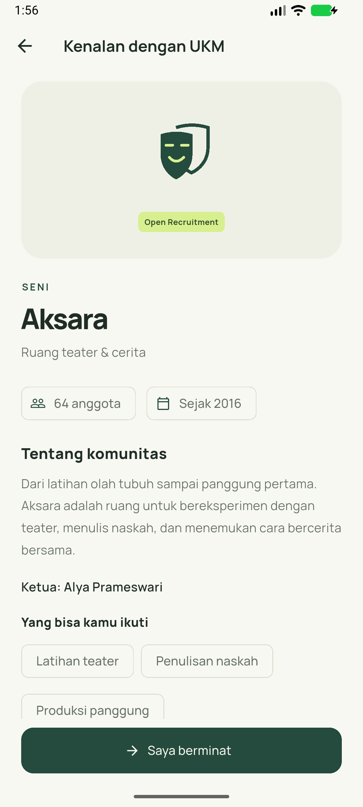 |

| Gambar 3. Form minat - tampilan awal | Gambar 4. Pendaftaran Saya - tampilan awal |
| --- | --- |
| 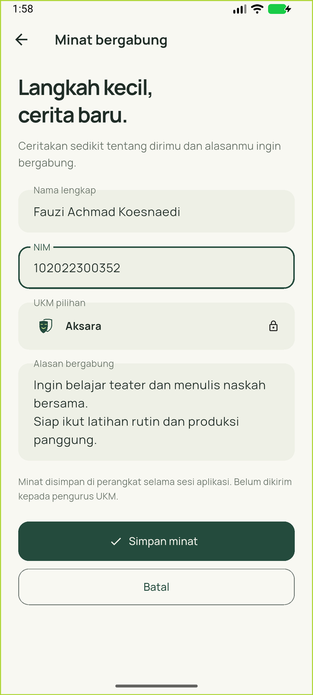 | 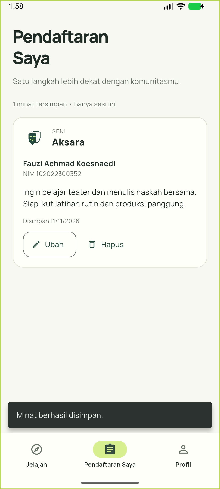 |

| Gambar 5. Profil | Gambar 6. Jelajah dengan tema gelap - tampilan awal |
| --- | --- |
| 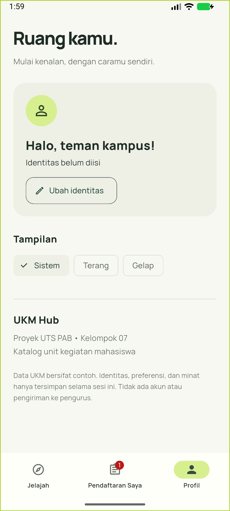 | 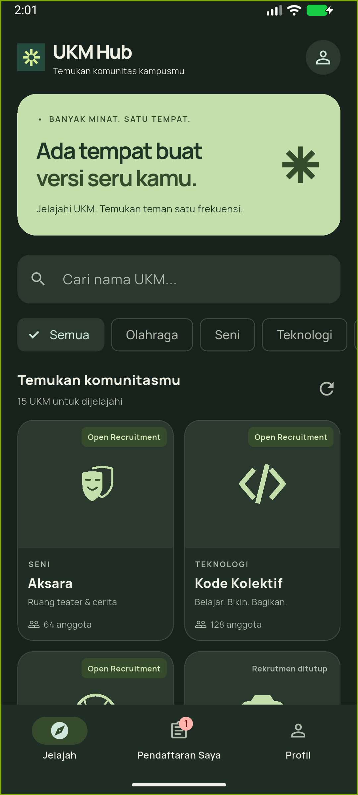 |

| Gambar 7. Filter bidang Teknologi | Gambar 8. Pesan gagal saat server dimatikan |
| --- | --- |
|  | 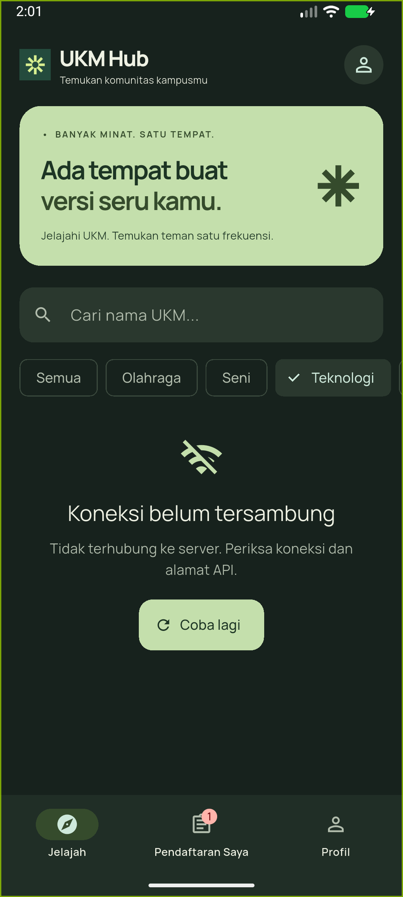 |

| Gambar 9. Katalog setelah Coba lagi berhasil | Gambar 10. Jelajah dengan pilihan tema |
| --- | --- |
| 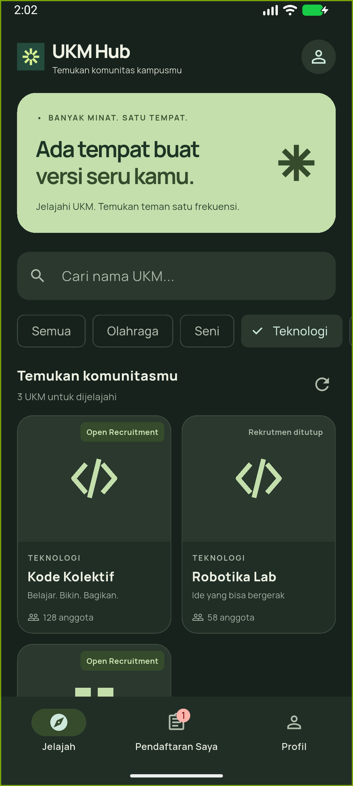 | 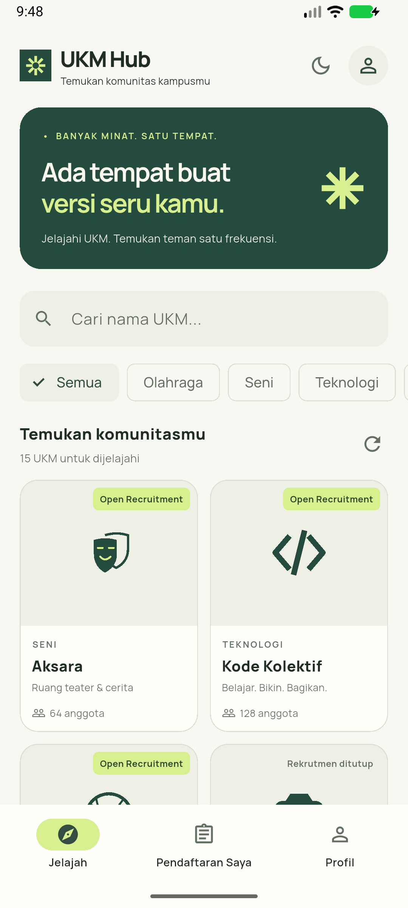 |

| Gambar 11. Detail dan identitas UKM | Gambar 12. Form minat dengan identitas UKM |
| --- | --- |
| 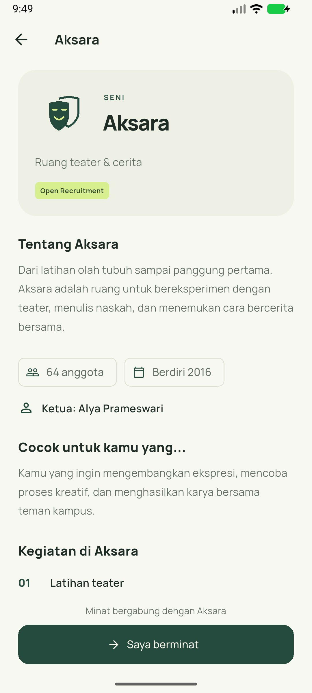 | 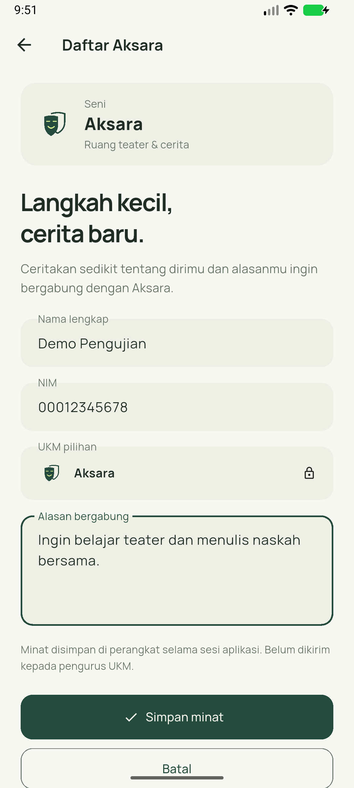 |

| Gambar 13. Hasil pada Pendaftaran Saya | Gambar 14. UKM yang sudah didaftari |
| --- | --- |
| 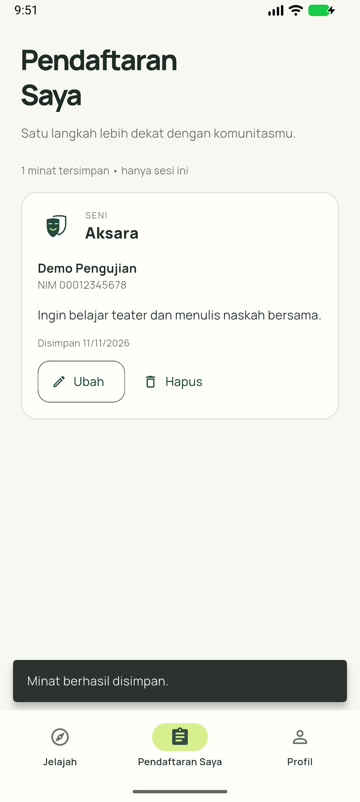 | 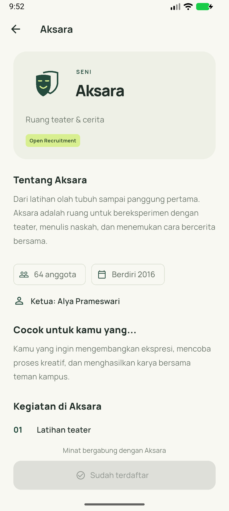 |

| Gambar 15. Jelajah dengan tema gelap | Gambar 16. Informasi kegiatan UKM |
| --- | --- |
|  | 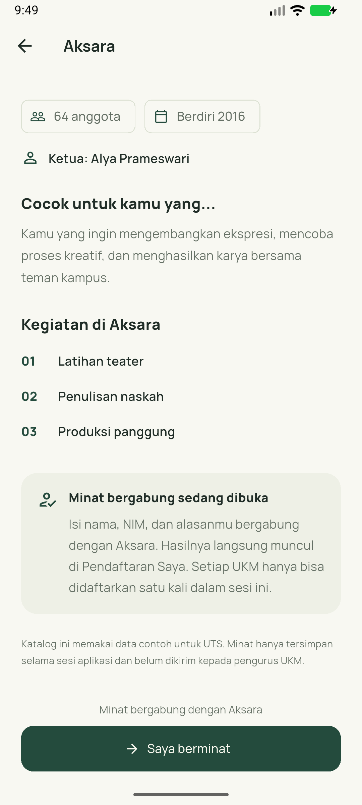 |

Tangkapan layar diperoleh dari emulator Android pada pengujian versi pengembangan tanggal 11 November 2026. Rincian pengambilan gambar tercatat pada [dokumentasi screenshot](screenshots/README.md) dan [catatan QA](docs/QA.md#asal-screenshot-yang-disertakan). Pengujian perangkat setelah penggabungan perubahan belum diulang. Oleh karena itu, kesesuaian gambar dengan versi akhir perlu dikonfirmasi sebelum pengumpulan.
<!-- SCREENSHOTS:END -->

## 4. Pemenuhan fitur wajib UTS

Pemenuhan fitur disajikan dalam 28 baris yang masing-masing mewakili satu poin pemeriksaan pada Bagian 3 panduan UTS. Kolom File:baris menunjukkan lokasi implementasi atau bukti pengujian relatif terhadap direktori utama repositori. Hasil pengujian tanggal 12 November 2026 tercatat pada [catatan QA](docs/QA.md#pemeriksaan-versi-gabungan-12-november-2026).

<!-- CHECKLIST:BEGIN -->
| Poin | File:baris | Keterangan |
| --- | --- | --- |
| P01–P02: 1. Pembuatan proyek dan nama paket | [docs/QA.md:9](docs/QA.md#L9); [app/android/app/build.gradle.kts:19](app/android/app/build.gradle.kts#L19) | Proyek dibuat dengan organisasi id.ac.telkomuniversity; nama paket Android id.ac.telkomuniversity.ukm_hub. |
| P01–P02: 2. Nama aplikasi pada launcher | [app/android/app/src/main/AndroidManifest.xml:4](app/android/app/src/main/AndroidManifest.xml#L4) | Nama aplikasi yang ditampilkan adalah UKM Hub. |
| P01–P02: 3. Android dan minimal 4 screenshot | [screenshots/README.md:1](screenshots/README.md#L1) | Sebanyak 16 tangkapan layar Android disajikan pada Bagian 3. Asal gambar dan catatan pengujian perangkat tercantum pada QA. |
| P01–P02: 4. Hasil flutter analyze | [docs/QA.md:54](docs/QA.md#L54) | flutter analyze selesai tanpa error maupun warning pada 12 November 2026. |
| P03: 1. StatelessWidget, StatefulWidget, dan setState | [app/lib/widgets/ukm_card.dart:8](app/lib/widgets/ukm_card.dart#L8); [app/lib/screens/main_page.dart:17](app/lib/screens/main_page.dart#L17); [app/lib/screens/main_page.dart:56](app/lib/screens/main_page.dart#L56) | UkmCard menggunakan StatelessWidget; MainPage menggunakan StatefulWidget dan setState untuk memperbarui tampilan. |
| P03: 2. TextField, controller, dan dispose | [app/lib/screens/jelajah_page.dart:199](app/lib/screens/jelajah_page.dart#L199); [app/lib/screens/jelajah_page.dart:46](app/lib/screens/jelajah_page.dart#L46) | Kolom pencarian menggunakan controller dengan pelepasan sumber daya melalui dispose. |
| P03: 3. Minimal 2 jenis tombol Material 3 | [app/lib/screens/registration_form.dart:219](app/lib/screens/registration_form.dart#L219); [app/lib/screens/registration_form.dart:232](app/lib/screens/registration_form.dart#L232) | Form menyediakan FilledButton dan OutlinedButton. IconButton juga digunakan pada aplikasi. |
| P03: 4. Pilihan menggunakan chip | [app/lib/screens/jelajah_page.dart:226](app/lib/screens/jelajah_page.dart#L226) | ChoiceChip menyediakan pilihan Semua dan lima bidang UKM. |
| P03: 5. Umpan balik menggunakan SnackBar | [app/lib/screens/main_page.dart:62](app/lib/screens/main_page.dart#L62) | SnackBar menampilkan pesan penyimpanan minat dan menyediakan aksi Urungkan setelah penghapusan. |
| P04: 1. Model minimal 6 field, DateTime, dan bool | [app/lib/models/ukm.dart:8](app/lib/models/ukm.dart#L8); [app/lib/models/ukm.dart:25](app/lib/models/ukm.dart#L25); [app/lib/models/ukm.dart:26](app/lib/models/ukm.dart#L26) | Ukm memiliki delapan field utama, termasuk bukaRekrutmen bertipe bool dan berdiri bertipe DateTime. |
| P04: 2. Kartu dengan Row, Column, Expanded, dan Stack | [app/lib/widgets/ukm_card.dart:87](app/lib/widgets/ukm_card.dart#L87); [app/lib/widgets/ukm_card.dart:31](app/lib/widgets/ukm_card.dart#L31); [app/lib/widgets/ukm_card.dart:34](app/lib/widgets/ukm_card.dart#L34); [app/lib/widgets/ukm_card.dart:35](app/lib/widgets/ukm_card.dart#L35) | UkmCard menyusun logo, informasi UKM, dan lencana rekrutmen menggunakan keempat widget tersebut. |
| P04: 3. Daftar menggunakan builder | [app/lib/screens/jelajah_page.dart:344](app/lib/screens/jelajah_page.dart#L344) | Katalog UKM ditampilkan menggunakan GridView.builder. |
| P04: 4. NavigationBar minimal 3 tab dan IndexedStack | [app/lib/screens/main_page.dart:135](app/lib/screens/main_page.dart#L135); [app/lib/screens/main_page.dart:168](app/lib/screens/main_page.dart#L168) | Tersedia tab Jelajah, Pendaftaran Saya, dan Profil; IndexedStack mempertahankan halaman saat berpindah tab. |
| P05: 1. Detail menerima objek melalui konstruktor | [app/lib/screens/main_page.dart:37](app/lib/screens/main_page.dart#L37); [app/lib/screens/detail_page.dart:14](app/lib/screens/detail_page.dart#L14) | Navigator.push membuka DetailPage dengan objek Ukm melalui konstruktor. |
| P05: 2. Form mengembalikan data dan memperbarui daftar | [app/lib/screens/registration_form.dart:59](app/lib/screens/registration_form.dart#L59); [app/lib/screens/main_page.dart:37](app/lib/screens/main_page.dart#L37); [app/lib/screens/main_page.dart:57](app/lib/screens/main_page.dart#L57) | Formulir mengembalikan data melalui Navigator.pop. MainPage menerima hasil dengan await, memperbarui daftar, dan menampilkan tab Pendaftaran Saya. |
| P05: 3. Pemeriksaan mounted setelah await | [app/lib/screens/main_page.dart:48](app/lib/screens/main_page.dart#L48); [app/lib/screens/detail_page.dart:58](app/lib/screens/detail_page.dart#L58) | Pemeriksaan mounted dilakukan sebelum penggunaan context atau pembaruan state setelah await. |
| P05: 4. Minimal 3 widget test dan hasil pengujian | [app/test/flows_test.dart:74](app/test/flows_test.dart#L74); [docs/QA.md:54](docs/QA.md#L54) | Sebanyak 12 widget test dan 5 tes layanan lulus pada 12 November 2026. |
| P06: 1. ThemeData, ColorScheme.fromSeed, dan darkTheme | [app/lib/core/theme.dart:12](app/lib/core/theme.dart#L12); [app/lib/core/app.dart:32](app/lib/core/app.dart#L32) | Aplikasi menyediakan tema terang dan gelap dengan warna dasar hijau. |
| P06: 2. Warna widget dari ColorScheme | [app/lib/widgets/ukm_card.dart:21](app/lib/widgets/ukm_card.dart#L21) | Warna widget diambil dari ColorScheme pada tema aplikasi. |
| P06: 3. Font kustom | [app/pubspec.yaml:22](app/pubspec.yaml#L22) | Font Manrope disimpan sebagai aset lokal dan disertai lisensi SIL OFL. |
| P06: 4. Ikon launcher sendiri | [app/pubspec.yaml:16](app/pubspec.yaml#L16); [app/android/app/src/main/AndroidManifest.xml:6](app/android/app/src/main/AndroidManifest.xml#L6) | Ikon UKM Hub dibuat menggunakan flutter_launcher_icons dan digunakan pada launcher Android. |
| P06: 5. Gambar aset lokal | [app/pubspec.yaml:20](app/pubspec.yaml#L20); [app/lib/widgets/hub_widgets.dart:25](app/lib/widgets/hub_widgets.dart#L25) | Aset gambar didaftarkan dalam pubspec dan logo ditampilkan melalui UkmLogo. |
| P07: 1. Shelf, Shelf Router, dan minimal 12 item JSON | [server/pubspec.yaml:8](server/pubspec.yaml#L8); [server/pubspec.yaml:9](server/pubspec.yaml#L9); [server/data/ukm.json:2](server/data/ukm.json#L2) | Server menggunakan shelf dan shelf_router. Dataset berisi 15 UKM dalam lima bidang. |
| P07: 2. GET daftar, detail, dan endpoint khas | [server/lib/api.dart:13](server/lib/api.dart#L13); [server/lib/api.dart:14](server/lib/api.dart#L14); [server/lib/api.dart:26](server/lib/api.dart#L26) | API menyediakan daftar UKM, detail berdasarkan ID, dan filter bidang pada server. |
| P07: 3. Paket http dan konfigurasi API_URL | [app/lib/services/api_service.dart:5](app/lib/services/api_service.dart#L5); [app/lib/services/api_service.dart:27](app/lib/services/api_service.dart#L27) | ApiService menggunakan paket http dengan alamat server yang ditentukan melalui konfigurasi API_URL. |
| P07: 4. fromJson, toJson, dan konversi DateTime | [app/lib/models/ukm.dart:38](app/lib/models/ukm.dart#L38); [app/lib/models/ukm.dart:45](app/lib/models/ukm.dart#L45); [app/lib/models/ukm.dart:52](app/lib/models/ukm.dart#L52) | Model menyediakan fromJson dan toJson dengan konversi tanggal ISO ke DateTime dan sebaliknya. |
| P07: 5. FutureBuilder dengan tiga keadaan | [app/lib/screens/jelajah_page.dart:241](app/lib/screens/jelajah_page.dart#L241); [app/lib/screens/jelajah_page.dart:258](app/lib/screens/jelajah_page.dart#L258); [app/lib/screens/jelajah_page.dart:267](app/lib/screens/jelajah_page.dart#L267) | FutureBuilder menangani pemuatan data, kegagalan dengan tombol Coba lagi, dan penyajian katalog setelah permintaan berhasil. |
| P07: 6. Pengujian menggunakan MockClient | [app/test/api_service_test.dart:20](app/test/api_service_test.dart#L20); [docs/QA.md:54](docs/QA.md#L54) | Lima tes MockClient lulus, mencakup filter, detail, status HTTP, format JSON, dan kegagalan koneksi. |
<!-- CHECKLIST:END -->

Nomor baris dapat diperbarui setelah perubahan kode melalui perintah berikut dari direktori utama repositori:

```powershell
python tools/update_maps.py --readme-only
```

## 5. Pengujian aplikasi dan server

### 5.1 Pengujian server

Perintah pengujian dari direktori utama repositori:

```powershell
cd server
dart pub get
dart analyze
dart test
```

Pengujian mencakup kelengkapan dataset, daftar UKM, detail, filter bidang, dan respons untuk data yang tidak ditemukan. Pemeriksaan logo pada dataset memerlukan aset di folder `app/assets`.

### 5.2 Pengujian aplikasi Flutter

Pengujian aplikasi dijalankan dari direktori utama repositori dengan perintah berikut:

```powershell
cd app
flutter pub get
flutter analyze
flutter test --concurrency=1
```

Pengujian pada 12 November 2026 menunjukkan bahwa analisis server dan Flutter selesai tanpa error maupun warning. Seluruh pengujian berhasil, dengan rincian 5 tes server dan 17 tes Flutter yang terdiri atas 12 widget test serta 5 tes layanan menggunakan MockClient. Rincian hasil dan batas pengujian tercatat pada [docs/QA.md](docs/QA.md#pemeriksaan-versi-gabungan-12-november-2026).

### 5.3 Pembuatan APK debug

APK debug dibuat dari direktori `app` menggunakan perintah berikut:

```powershell
flutter build apk --debug --dart-define=API_URL=http://10.0.2.2:8080
```

Berkas APK dihasilkan pada `app/build/app/outputs/flutter-apk/app-debug.apk`. Konfigurasi pada perintah tersebut menggunakan alamat server untuk emulator. Apabila APK digunakan pada perangkat Android melalui jaringan lokal, nilai `API_URL` saat build disesuaikan dengan IP komputer server.

## 6. Implementasi fitur khas UKM Hub

| Ketentuan Proyek 4 | Implementasi |
| --- | --- |
| Model Ukm | id, nama, bidang, ketua, jumlahAnggota, bukaRekrutmen, berdiri, dan logo |
| Lima bidang | Olahraga, Seni, Teknologi, Keagamaan, dan Sosial |
| Tiga tab | Jelajah, Pendaftaran Saya, dan Profil |
| Form minat bergabung | Nama, NIM, UKM pilihan, dan alasan multi-baris |
| Katalog berisi logo | GridView.builder dengan aset logo lokal |
| Lencana Open Recruitment | Stack dan Positioned pada kartu UKM |
| Filter bidang | GET /ukm?bidang=... dengan penyaringan pada server |

Selain fitur wajib, aplikasi menyediakan pull-to-refresh dan animasi Hero pada perpindahan dari kartu ke halaman detail. Pengiriman pendaftaran melalui POST belum diterapkan. Data hasil formulir disimpan dalam memori aplikasi sesuai ketentuan wajib UTS.

## 7. Dokumentasi video dan kelengkapan pengumpulan

**Tautan video demo: belum diisi.**

Video demonstrasi harus berdurasi 3-5 menit dengan cakupan sebagai berikut:

1. Proses menyalakan server.
2. Aplikasi memuat data dari server.
3. Keadaan gagal saat server dimatikan, kemudian berhasil setelah server dinyalakan dan Coba lagi ditekan.
4. Semua tab aplikasi.
5. Halaman detail UKM.
6. Pengisian form sampai data muncul di daftar.
7. Hasil `flutter test`.

Skenario kegagalan koneksi diperagakan dengan mematikan server, kemudian melakukan refresh atau mengubah filter agar aplikasi mengirim permintaan baru.

Berdasarkan Bagian 8 panduan UTS, pengumpulan dilakukan oleh satu anggota atas nama kelompok melalui LMS dengan kelengkapan berikut:

- Tautan repository yang dapat diakses dosen.
- ZIP isi repository tanpa folder `build/`, `.dart_tool/`, dan `android/.gradle/`.
- APK debug.
- Tautan video demo melalui YouTube unlisted atau Google Drive.

Tautan video dicantumkan setelah rekaman tersedia. Kode sumber, tangkapan layar, APK, dan video harus sesuai dengan versi aplikasi yang dikumpulkan. Tenggat pengumpulan mengikuti ketentuan pada LMS.

## 8. Struktur proyek

```text
UKM-HUB-KELOMPOK7/
  app/                   Aplikasi Flutter, aset, dan pengujian
  server/
    bin/server.dart      Menjalankan server dan membaca dataset
    lib/api.dart         Endpoint API dan respons JSON
    data/ukm.json        Dataset 15 UKM
    test/                Pengujian server
  screenshots/           Screenshot Android
  docs/                  Catatan QA dan panduan proyek
  tools/                 Skrip pembaruan dokumentasi
  README.md
```

Dokumentasi pendukung: [panduan memulai](docs/START_HERE.md), [pembagian modul](docs/OWNERSHIP.md), dan [daftar tugas](docs/TASKS.md). Font Manrope disertai lisensi SIL OFL pada `app/assets/fonts/Manrope-OFL.txt`.
